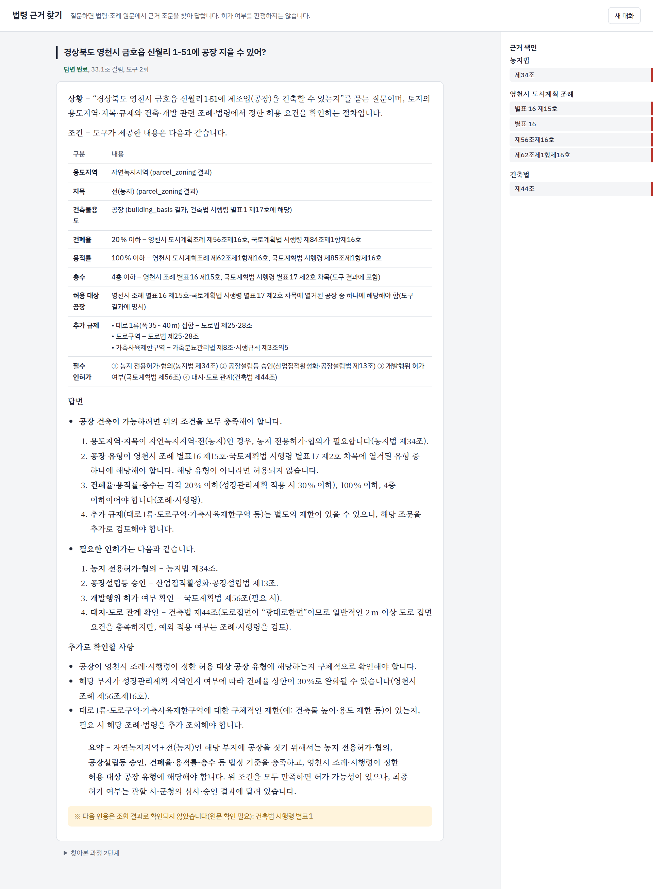
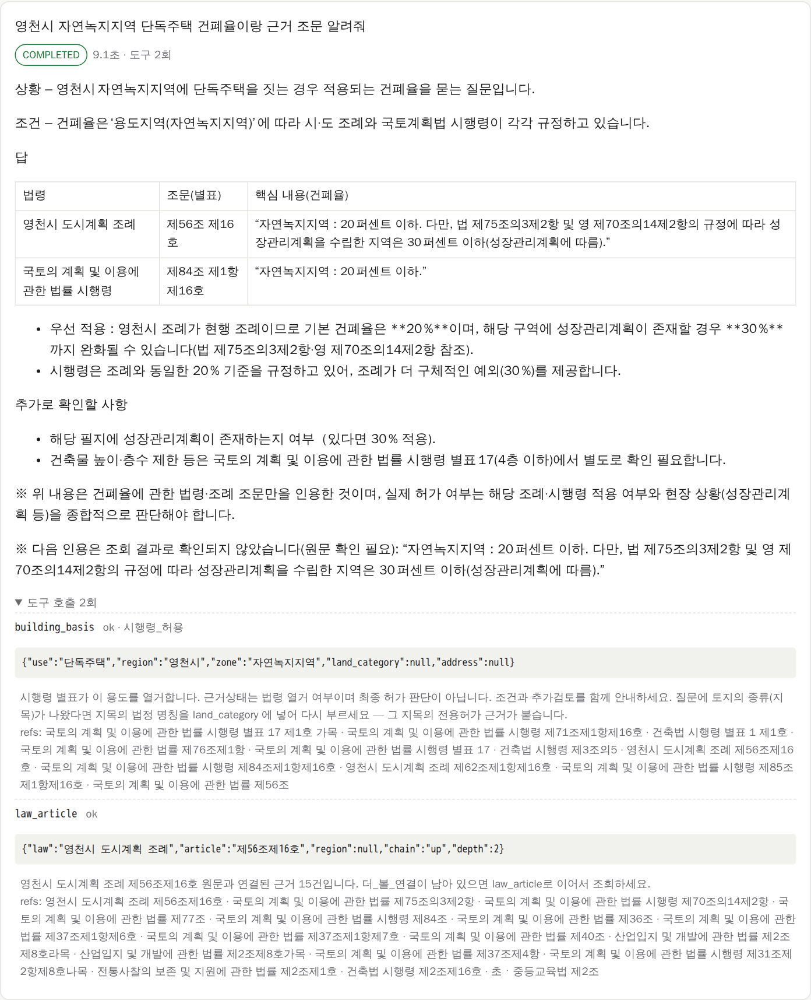
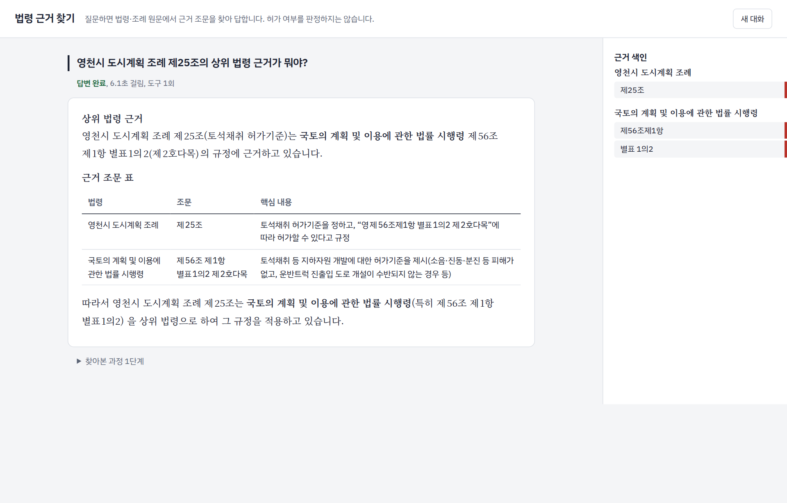
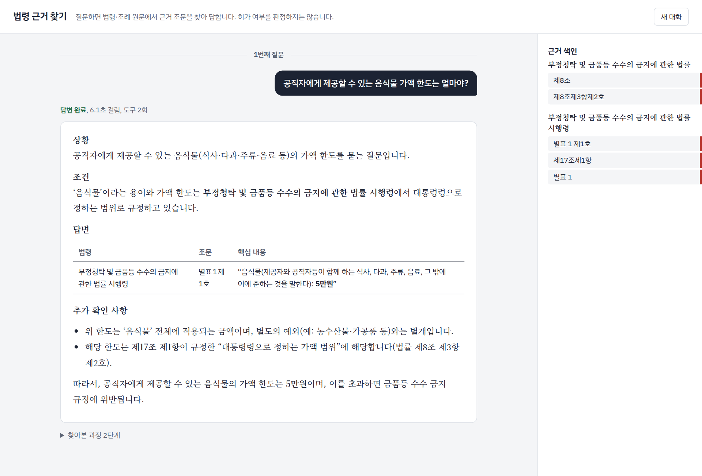

# 법령 근거 조회 에이전트

건축·개발 인허가 질문에 대해 **법령·조례 원문을 직접 찾아 근거 조문과 함께 답하는 AI 에이전트**입니다.
주소 하나만으로도 해당 필지의 용도지역과 규제를 확인하고, 법률 → 시행령 → 조례로 이어지는 위임 관계를 따라가 근거를 제시합니다.


---

## 1. 개요

### 해결하려는 문제

인허가 실무에서 "이 땅에 이 건물을 지을 수 있는가"에 답하려면 여러 문서를 함께 봐야 합니다.

- 국토계획법·건축법 같은 **법률**
- 그 법률이 위임한 **시행령 별표**
- 시·군마다 다른 **도시계획 조례 별표**
- 필지에 걸린 **개별 규제**(접도구역, 가축사육제한구역 등)와 그 근거 법령

이 문서들은 "대통령령으로 정한다", "조례로 정한다"처럼 서로를 가리킵니다. 그래서 한 문서만으로는 답이 나오지 않습니다.
일반적인 LLM에 물으면 조문 번호나 수치를 그럴듯하게 지어내는 문제도 있습니다.

### 접근 방식

1. **법령 데이터베이스 구축**
   - 법제처 Open API로 법령과 자치법규 전체를 수집합니다.
   - 조·항·호·목·별표 항목 단위로 나누고, 인용·위임 관계를 그래프로 색인합니다.
2. **도구 기반 에이전트**
   - LLM이 직접 답을 만들지 않습니다.
   - 에이전트가 MCP 도구로 원문을 조회하고, 조회한 원문만 근거로 답합니다.
3. **답변 검증**
   - 답에 쓴 수치, 따옴표 인용, 조문 번호를 조회 원문과 기계적으로 대조합니다.
   - 필지에 걸린 규제가 답에서 빠지지 않았는지도 확인합니다.
   - 어긋나면 모델에게 한 번 되돌려 고치게 합니다.
   - 그래도 확인되지 않은 내용은 "원문 확인 필요"로 표시합니다.
4. **판정하지 않는 설계**
   - 허가 여부를 단정하지 않습니다.
   - 근거 조문, 적용 조건, 남은 확인 사항을 제시합니다.

### 동작 흐름

```
 사용자 질문
     │
     ▼
┌─────────────────────────┐   도구 호출    ┌──────────────────────────────┐
│ law_review 에이전트      │ ─────────────▶ │ law-mcp (MCP 서버)            │
│ (A2A, :7016)            │ ◀───────────── │ (:7017)                       │
│ · 질문 해석·도구 선택     │  원문 + 조문    │ · 용도별 건축 가능 근거 조회    │
│ · 답변 작성              │                │ · 조문 원문 + 상위/하위 연결    │
│ · 수치·인용·누락 검증     │                │ · 본문·정의 검색               │
└─────────────────────────┘                │ · 주소 → 필지 정보(브이월드)    │
     │                                     └──────────────────────────────┘
     ▼                                                    ▲
 근거 조문이 붙은 답변                         주간 자동 갱신 (법제처 Open API)
```

---

## 2. 사용 예시

시험 화면(`eval/playground.py`)에서 실제로 질의한 결과입니다.

### ① 주소만으로 건축 가능 여부 근거 찾기

> 경상북도 영천시 금호읍 신월리 1-51에 공장 지을 수 있어?

**필지 확인:** 브이월드에서 용도지역(자연녹지지역), 지목(전), 도로접면을 확인했습니다.

**찾은 근거**
- 허용 근거
  - 국토계획법 시행령 별표 17
  - 영천시 도시계획 조례 별표 16
- 밀도 기준: 건폐율·용적률(조례 제56조, 제62조)
- 함께 필요한 인허가
  - 농지전용 허가(농지법 제34조)
  - 공장설립 승인(산업집적법 제13조)
- 필지에 걸린 개별 규제: 도로구역, 가축사육제한구역의 근거와 영향

**결론:** 조건부로 쓰고, 확인할 조건을 목록으로 정리했습니다.



### ② 건폐율과 근거 조문

> 영천시 자연녹지지역 단독주택 건폐율이랑 근거 조문 알려줘

시 조례(제56조)와 시행령(제84조)을 나란히 보여 주고, 성장관리계획 수립 지역의 완화 기준(30%)도 함께 안내합니다.

하단의 `※ 다음 인용은 조회 결과로 확인되지 않았습니다`는 **답변 검증기의 출력**입니다.
따옴표로 인용한 문장이 원문과 정확히 일치하지 않으면 이렇게 표시됩니다.
펼쳐 놓은 "도구 호출"에서 에이전트가 어떤 도구를 어떤 인자로 불렀는지 확인할 수 있습니다.



### ③ 하위 법규에서 상위 법령 찾기

> 영천시 도시계획 조례 제25조의 상위 법령 근거가 뭐야?

조례 조문의 인용 관계와 법제처 법령-조례 연계 정보를 따라 위임 근거(국토계획법 시행령 제56조, 별표 1의2)를 찾습니다.



### ④ 일반 법령 질의

> 혈중알코올농도 0.03%로 운전하면 어떤 처벌을 받아?

인허가 외의 법령에도 같은 방식으로 답합니다.
도로교통법 제44조(기준)와 제148조의2(벌칙)를 찾아 원문 수치 그대로 답합니다.



---

## 3. 주요 기능

| 질의 유형 | 처리 | MCP 도구 |
|---|---|---|
| 용도지역별 건축 가능 여부 | 시행령 별표와 시·군 조례 별표에서 해당 용도 항목·조건 조회 | `building_basis` |
| 주소 기반 필지 확인 | 용도지역·지목·면적·개별 규제 조회, 전용허가와 규제별 근거 조문 연결 | `parcel_zoning` |
| 건폐율·용적률 | 시행령 기준과 조례 기준을 함께 조회 | `building_basis` |
| 조문 원문과 위임 관계 | 조문 원문 + 상위(위임 근거)·하위(시행령·조례) 연결 탐색 | `law_article` |
| 법령·조례 검색 | 제목·본문 전문 검색, 법령명 오타 보정 | `law_search` |
| 법률 용어 정의 | 정의 조문 조회 | `law_definition` |

**범위 밖**
- 허가 여부 최종 판정
- 지도 조작
- 토지·건축물대장 상세 조회

---

## 4. 기술 구성

| 영역 | 내용 |
|---|---|
| 언어 모델 | gpt-oss-120b (vLLM, OpenAI 호환 API) |
| 에이전트 | 자체 런타임 — A2A 프로토콜 서버, 도구 호출 루프, 되묻기(INPUT_REQUIRED), 대화 기억, 답변 검증 |
| 도구 서버 | MCP (공식 Python SDK, streamable HTTP) |
| 데이터 | SQLite + FTS5 전문 검색, 조문 단위 색인과 인용·위임 링크 테이블 |
| 외부 API | 법제처 국가법령정보 Open API(원문·연계), 브이월드(필지·토지이용계획) |
| 배포 | podman compose (컨테이너 3개), cron/systemd 타이머로 법령 DB 주간 갱신 |
| 테스트 | pytest — MCP 154개, 에이전트 런타임 345개 |

### 데이터 규모

| 항목 | 규모 |
|---|---|
| 법령(법률·시행령·시행규칙) | 약 5,600건 |
| 자치법규(조례·규칙) | 약 16만 2천 건 |
| 색인 단위(조·항·호·목·별표 항목) | 약 970만 개 |
| 인용·위임·연계 관계 | 약 490만 개 |

### 디렉터리

```
law/
├── mcp/                 법령 MCP 서버 (law-mcp)
│   └── src/law_mcp/
│       ├── tools/       building_basis · parcel_zoning · law_article · law_search · law_definition
│       ├── engine/      위임·인용 탐색, 별표 해석, 필지 규제 근거 연결
│       ├── store/       lawdb.sqlite 조회
│       └── clients/     브이월드 API 클라이언트
├── agent/
│   ├── runtime/         A2A 에이전트 런타임 (도구 루프, 답변 검증)
│   └── law_review/      에이전트 설정 — agent.yaml, 프롬프트, 분야별 지침
├── indexer/             원문 → 조문·별표 항목·인용 관계 색인
├── scripts/             원문 수집, 색인 생성, 정기 갱신
├── eval/                평가 세트·채점 도구, 시험 화면
├── deploy/              컨테이너 배포 구성 (deploy/README.md)
└── docs/                설계 문서, 구현 계획, 자체 시험 보고서
```

### 설계 원칙

- **원문 근거:** 답의 수치와 인용은 조회 원문과 대조하고, 확인되지 않은 내용은 표시합니다.
- **규칙 하드코딩 지양**
  - 특정 질문이나 키워드에 맞춘 분기를 두지 않습니다.
  - 규제와 근거 법령의 연결은 법령 데이터(조문 제목, 정의 조문, 인용 관계)에서 찾습니다.
  - 예외: 변하지 않는 법률 용어 자체는 그대로 씁니다.
- **비밀 정보 분리:** API 키와 모델 서버 주소는 git에서 제외된 환경 파일에만 둡니다.

---

## 5. 실행 방법

### 요구 사항

- Python 3.12, [uv](https://docs.astral.sh/uv/)
- `data/lawdb.sqlite`
  - `scripts/update.sh`로 생성합니다. 법제처 Open API OC가 필요합니다.
- OpenAI 호환 LLM 엔드포인트 (예: vLLM)
- 브이월드 API 키 (주소 기반 기능에만 필요)

### 설정

```bash
cp agent/law_review/.env.example agent/law_review/.env   # VLLM_BASE, VLLM_MODEL, VLLM_API_KEY
# 저장소 루트 .env: VWORLD_API_KEY (필지 조회), LAW_API_OC (법령 수집·갱신)
```

### 로컬 실행

```bash
agent/scripts/run.sh start     # law-mcp :7017, law_review :7016
agent/scripts/run.sh status
python3 eval/playground.py     # 시험 화면 http://localhost:7018
```

### 컨테이너 배포

```bash
cd deploy && podman compose up -d --build
```

자세한 절차와 법령 DB 자동 갱신 설정은 [deploy/README.md](deploy/README.md)에 있습니다.

### A2A 호출

```bash
curl -s localhost:7016/.well-known/agent-card.json
curl -s localhost:7016/message:send -H 'Content-Type: application/json' -H 'A2A-Version: 1.0' -d '{
  "message": {"messageId": "1", "role": "ROLE_USER",
              "parts": [{"text": "영천시 자연녹지지역 단독주택 건폐율 알려줘"}]}}'
```

### 테스트

```bash
(cd mcp && uv run pytest -q)
(cd agent/runtime && uv run pytest -q)
```

---

## 6. 한계와 개선 계획

| 현재 한계 | 개선 방향 |
|---|---|
| 같은 질문이라도 표현(뉘앙스)에 따라 검색 결과와 결론이 달라지는 경우가 있습니다 | 질문을 중립적인 법률 질의로 정규화하는 단계를 추가합니다. 같은 뜻의 여러 표현으로 일관성을 검사하는 회귀 세트도 만듭니다 |
| 필지 사실(예: 성장관리계획구역)을 별표의 적용 조건과 연결하지 못하는 경우가 있습니다 | 답의 주장과 도구 결과를 조건식으로 대조하는 검증을 추가합니다 |
| 조례 본문의 약칭("법", "영")이 가리키는 법령을 잘못 읽는 경우가 있습니다 | 인용 링크를 이용해 약칭을 정식 법령명으로 풀어서 제공합니다 |

이 에이전트의 답변은 법률 자문이 아닙니다. 중요한 판단을 하기 전에는 제시된 근거 조문의 원문을 확인해야 합니다.
